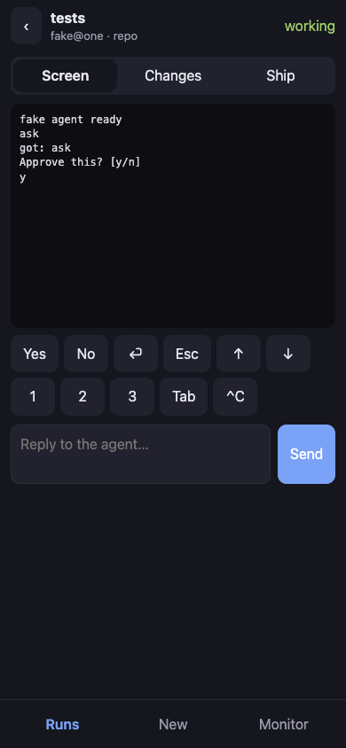

# amux

**Many accounts, one shared home, for Claude Code, Codex, Gemini CLI and other agent CLIs.**

[](https://github.com/quynb93/amux/actions/workflows/ci.yml)
[](LICENSE)


Agent CLIs keep everything in one home directory: your login, but also your skills, plugins, MCP servers, settings and session history. Using a second account usually means a second home directory, and then nothing is shared between them.

amux gives each account its own login and shares everything else.

```console
$ amux account add claude work
$ amux account add claude personal
$ amux claude@work                  # Claude Code, signed in as work
$ amux claude@personal              # same skills, plugins and sessions, different login
$ amux resume 2f26fba2 --as claude@personal   # pick up a work session under the other account
```

It also runs many agents at once, each in its own git worktree. You can watch them and type into them in one screen, and amux keeps them from overloading the machine. When they finish, it reviews their changes, catches conflicts between them, and lands, tests or ships the work. You can drive all of it from your phone, another laptop or another agent.


## Contents

- [Features](#features)
- [Install](#install)
- [Quick start](#quick-start)
- [How it works](#how-it-works)
- [Usage](#usage)
  - [Accounts and sign-in](#accounts-and-sign-in)
  - [Sessions and handoff](#sessions-and-handoff)
  - [Parallel runs](#parallel-runs)
  - [Driving runs from scripts and agents](#driving-runs-from-scripts-and-agents)
  - [Reviewing a run's changes](#reviewing-a-runs-changes)
  - [Shared notes and separate ports](#shared-notes-and-separate-ports)
  - [Best of N](#best-of-n)
  - [Usage limits](#usage-limits)
  - [Runaway and stuck agents](#runaway-and-stuck-agents)
  - [Landing parallel runs](#landing-parallel-runs)
  - [Pull requests and CI](#pull-requests-and-ci)
  - [Other machines](#other-machines)
  - [On your phone](#on-your-phone)
  - [Plugins and hooks](#plugins-and-hooks)
  - [Agents that run agents](#agents-that-run-agents)
  - [Sharing the machine](#sharing-the-machine)
  - [Privacy mode](#privacy-mode)
  - [Gateways and custom endpoints](#gateways-and-custom-endpoints)
  - [Shell integration](#shell-integration)
  - [Other CLIs](#other-clis)
  - [Updates](#updates)
- [Command reference](#command-reference)
- [Files and environment](#files-and-environment)
- [Moving from separate config dirs](#moving-from-separate-config-dirs)
- [Troubleshooting](#troubleshooting)
- [Responsible use](#responsible-use)
- [Roadmap](#roadmap) · [Contributing](#contributing) · [License](#license)

## Features

- **Multiple accounts per CLI.** Claude Code, Codex and Gemini CLI work out of the box. Any CLI that moves its home directory with an environment variable can be added with a few lines of JSON.
- **One shared home.** Skills, plugins, agents, commands, hooks, MCP config, settings and session history are shared. Only the login and per-account state stay separate.
- **Run accounts side by side.** Each launch gets its own overlay directory, so two accounts can run at the same time in different terminals.
- **Sign in your way.** Use the CLI's own login flow or a stored token (macOS Keychain, or a `0600` file on Linux).
- **Sessions across accounts and CLIs.** List every session from every CLI in one place. Resume one under another account, or hand it to a different CLI with a transcript handoff.
- **Parallel runs.** Start several agents in the background, across accounts and CLIs, each in its own git worktree if you like. See which are working and which are waiting, attach to any of them, and detach again.
- **Per-account options.** Privacy mode applies the CLI's documented telemetry opt-outs. A base URL sends that account's requests to a gateway you control.
- **One small binary.** Written in Rust. It starts in a few milliseconds and needs no runtime such as Node.js.

## Install

amux runs on macOS and Linux. On Windows, use it inside [WSL](https://learn.microsoft.com/windows/wsl/); native Windows support is [planned](https://github.com/quynb93/amux/issues/1).

**Homebrew** (macOS and Linux):

```sh
brew install quynb93/tap/amux
```

**Install script** (macOS and Linux). It downloads the binary for your machine from the latest GitHub release, checks its SHA-256 checksum, and puts it in `~/.local/bin`:

```sh
curl -fsSL https://github.com/quynb93/amux/releases/latest/download/install.sh | sh
```

Set `AMUX_INSTALL_DIR` to install somewhere else, or `AMUX_VERSION=0.2.0` for a specific version.

**npm.** The package contains the prebuilt binaries, so installing it runs no scripts:

```sh
npm install -g @quynb/amux
```

**Manual download.** Each [release](https://github.com/quynb93/amux/releases/latest) has an `amux-<target>.tar.gz` for macOS (Apple silicon and Intel) and Linux (arm64 and x86_64, statically linked), with a `.sha256` file for each.

**From source** (Rust 1.88 or newer):

```sh
cargo install --git https://github.com/quynb93/amux --locked
```

To upgrade, run `amux update`. It prints the right command for how you installed amux: `brew upgrade amux`, the npm command, or the install script.

**Upgrading from 0.1.x.** Versions 0.1.x ran on Node.js. The binary releases replace them, and your accounts and settings in `~/.amux` carry over unchanged. If you installed 0.1.0 or 0.1.1 with npm, run `npm uninstall -g amux` first, because those were packaged as `amux` rather than `@quynb/amux`.

Check it worked:

```sh
amux --version
amux doctor          # finds the claude/codex/gemini binaries and their homes
```

## Quick start

```sh
# 1. Add accounts. `add` creates the account's overlay and starts the CLI's sign-in.
amux account add claude work
amux account add claude personal
amux account add codex work

# 2. Choose the account that plain `amux claude` uses.
amux account default claude@work

# 3. Run. Extra arguments go straight to the CLI.
amux claude                        # claude@work
amux claude@personal --model opus  # claude@personal with a flag for Claude Code

# 4. Check who is signed in where.
amux account status
```

## How it works

Each account gets a small overlay directory under `~/.amux/accounts/`. Inside it, every entry is a symlink back into the real shared home, except the files that hold that account's login and state:

```
~/.claude                                  shared home: skills, plugins, projects/, settings.json, …
~/.amux/accounts/claude/work/.claude       overlay for claude@work
    .claude.json                           private: the signed-in account and per-account state
    skills   -> ~/.claude/skills           everything else links to the shared home
    projects -> ~/.claude/projects
    settings.json -> ~/.claude/settings.json
```

`amux claude@work` sets the CLI's home variable to that overlay and starts the CLI. The CLI sees a normal home directory. Anything shared that it writes, such as sessions, goes through the links into the shared home. Its login stays in the overlay, or on macOS in a Keychain entry that Claude Code names after the config directory.

| CLI | Home variable amux sets | Kept private per account |
|---|---|---|
| `claude` | `CLAUDE_CONFIG_DIR` | `.claude.json`, `.credentials.json`, Keychain login, `policy-limits.json*`, `remote-settings.json*`, telemetry and stats state, `backups` |
| `codex` | `CODEX_HOME` | `auth.json` |
| `gemini` | `GEMINI_CLI_HOME` (the parent of `.gemini`) | `oauth_creds.json`, `google_accounts.json` |

Overlays are refreshed on every launch. New entries in the shared home get linked, and links whose target is gone get removed. amux never deletes a real file. See [docs/architecture.md](docs/architecture.md) for the details.

## Usage

### Accounts and sign-in

```sh
amux account add <cli> <name>                 # create, then run the CLI's login (e.g. `claude auth login`)
amux account add <cli> <name> --no-login      # create only; sign in later with `amux <cli>@<name>`
amux account add <cli> <name> --token         # store a token instead of a login (read from stdin)
amux account add <cli> <name> --note "client X"
amux account token claude@ci < token.txt      # store or replace a token later
amux account list
amux account default claude@work
amux account rm claude@old                    # keeps the overlay's private files
amux account rm claude@old --purge            # deletes the overlay too (the shared home is untouched)
```

Token sign-in sets the CLI's token variable at launch. For Claude Code that is `CLAUDE_CODE_OAUTH_TOKEN`, created with `claude setup-token`. For Codex it is `OPENAI_API_KEY`, and for Gemini CLI it is `GEMINI_API_KEY`. Tokens are stored in the macOS Keychain under the service `amux`. On Linux they go in a `0600` file inside the account's directory.

Account names may use letters, digits, `.`, `_` and `-`. If a CLI has a single account, or a default, then `amux claude` is enough. Otherwise use `amux claude@<name>`.

### Sessions and handoff

Sessions are written to the shared home, so every account sees all of them.

```sh
amux sessions                      # every CLI, newest first
amux sessions codex --here -n 50   # only Codex, only this directory
```

```
PROVIDER  SESSION                               UPDATED  DIR             FIRST PROMPT
claude    2f26fba2-6c1e-4f0b-9a57-3f0e1d1c8b11  5m ago   ~/code/app      Fix the login redirect loop
codex     01a01da9-77f2-4c0e-bb1f-2b8c0d6e4a90  2h ago   ~/code/api      Add pagination to /orders
```

Resume by ID or by any unique prefix of it:

```sh
amux resume 2f26fba2 --as claude@personal   # same CLI: native resume under another account
amux resume 01a01da9 --as claude@work       # Codex → Claude: transcript handoff
```

For the same CLI, `resume` uses the CLI's own resume command, which is useful when an account hits its rate limit. Across CLIs, amux writes the original request and the most recent turns to a Markdown file in `~/.amux/handoffs/`. It then starts the target CLI in the session's directory and asks it to read that file and continue.

### Parallel runs

`amux spawn` starts a CLI in the background, in a terminal of its own, and returns right away. Start as many as you like, under any accounts.

```sh
amux spawn --worktree claude@work          # its own git worktree on branch amux/claude-1
amux spawn --worktree codex@personal       # a second agent on the same repo, on amux/codex-1
amux spawn --name review claude@work -p "review the open diff"

amux ps
# RUN       ACCOUNT          STATE     STARTED  DIR                              BRANCH         ARGS
# claude-1  claude@work      running   2m ago   ~/.amux/worktrees/app-claude-1   amux/claude-1
# codex-1   codex@personal   waiting 40s  1m ago   ~/.amux/worktrees/app-codex-1    amux/codex-1
# review    claude@work      exited 0  30s ago  ~/src/app                        -              -p review the open diff

amux attach codex-1      # work with it as usual; Ctrl-] detaches and leaves it running
amux logs review         # everything the run printed
amux explain codex-1     # why it shows "waiting": which signal decided, and its screen
amux stop claude-1       # SIGTERM; --force for SIGKILL
amux rm --done           # remove finished runs
```

Or see them all at once with **`amux ui`**: a list of runs with their state, and a live view of the selected run's screen.

- **Type right into a run.** Press Enter, click its screen, or just start typing a word: keys go to the agent in its pane, as in a terminal. The pane gets the accent border, and the run is resized to fit it. Pasting works too.
- **While typing**, Ctrl-] goes back to the list. Ctrl-B then a key runs one command (Ctrl-B s stops the run, Ctrl-B n starts one, Ctrl-B ? lists them), and Alt-↑/↓ switches to the run above or below.
- **Mouse.** Click a run to select it, and click its screen to type into it. The wheel moves through the list or scrolls the screen back. A CLI that asks for mouse reports gets them while you type into it. To select text with the mouse, hold Shift (Option in iTerm2 and Terminal.app).
- **Layout.** `/layout width 40`, `/layout side right`, and `/layout tiles 6` (up to six live screens) change the layout. `/layout save` keeps it, with the current view, in `~/.amux/config.json`:

  ```json
  { "ui": { "layout": { "view": "tiles", "listWidth": 40, "listSide": "left", "maxTiles": 6 } } }
  ```
- **Views.** 

  **`b`** shows a board with a column per state: needs you, working, idle and done. Each run is a card, and ←→ and ↑↓ move between cards. **`t`** shows tiles: up to four live runs side by side, each a terminal you can click into and type into. `b` or `t` again goes back to the list, and `/view` switches too.
- **In the list**, letters are shortcuts: `a` gives the run the whole terminal, Tab jumps to the next run that is waiting for you, `n` starts a run (account, prompt, worktree), `s` stops one and `d` removes it. `?` lists every key. Quitting the UI leaves the runs going.

Press **`/`** for the command palette. Type part of a command and its argument completes from your runs, accounts or themes:

| Command | What it does |
|---|---|
| `/new [account] [prompt]` | Start a run (`n`) |
| `/attach`, `/stop`, `/kill`, `/rm` `[run]` | The same as Enter, `s`, `S`, `d`, on the selected run or the one you name |
| `/clean` | Remove every finished run |
| `/logs [run]` | Read a run's output in your pager |
| `/filter [text]` | Show only runs whose name, account, branch or folder matches. Esc shows all again |
| `/show [waiting\|working\|idle\|ended\|all]` | Show only runs in one state (`f` steps through them) |
| `/explain [run]` | Why a run shows its state (`e`), the same as `amux explain` |
| `/switch-account <provider@name>` | Make an account the default for its CLI and for new runs |
| `/add-account <provider> <name> [--token]` | Add an account and sign in, right from the UI |
| `/accounts`, `/doctor` | Show `amux account list` or `amux doctor` |
| `/theme [name]` | List themes, or switch and save one |
| `/help`, `/quit` | |

**Themes.** There are four built in:
- `default` uses your terminal's own colors, so it suits light and dark terminals.
- `dark` and `light` are tuned for contrast on truecolor terminals.
- `mono` uses no color, and is picked automatically when `NO_COLOR` is set.

A light terminal background that reports itself (`COLORFGBG`, with truecolor) gets `light` automatically. Pick one with `/theme`, or in `~/.amux/config.json`. Change single colors there, or make your own theme in `~/.amux/themes/<name>.json`:

```json
{ "ui": { "theme": "dark", "colors": { "accent": "#ff9e64", "waiting": "#e0af68 bold" } } }
```

```json
{ "extends": "dark", "colors": { "selection": "on #2d3149", "done": "green" } }
```

A color is `#rrggbb`, a number from 0 to 255, a name (`red`, `bright-blue`, `default`…), plus `bold`, `dim`, `italic`, `underline` or `reverse`, and `on <color>` for the background. The roles are `text`, `muted`, `border`, `title`, `accent`, `key`, `selection`, `header`, `input`, `starting`, `working`, `waiting`, `idle`, `done`, `failed`, `lost`, `stopped`, `success` and `error`. `/theme` lists them too.

- **STATE** is `waiting <time>` when the CLI is asking you something: a permission or confirmation prompt, a terminal bell, or a notification it sent to the terminal. Otherwise it is `running` while the CLI prints and `idle <time>` once it has been quiet for a few seconds. Typing into the run clears `waiting`.
- **Self-reported state.** CLIs that report their own state with OSC 7501 (Codex, and Claude Code 2.1.295 and later) get exact states: `waiting` with the CLI's own message ("approve Write: a.rs"), `running`, `idle` once the turn is done, and `error`. amux answers Claude Code's request to report. For other CLIs, amux falls back to the prompt text in `waitingPatterns` and to output timing.
- **Notifications.** When a run starts waiting, or exits, and no terminal is attached to it, amux shows a desktop notification (Notification Center on macOS, `notify-send` on Linux). Set `"notify": false` in `~/.amux/config.json` to turn them off, or `"notifyCommand": ["my-notifier"]` to run your own command. It gets `AMUX_RUN`, `AMUX_EVENT` (`waiting` or `exited`), `AMUX_TITLE` and `AMUX_MESSAGE` in its environment.
- **`--worktree`** runs `git worktree add` on a new branch (`amux/<run>`, or `--branch <name>`) from `HEAD` (or `--base <ref>`). The run starts in the same subdirectory you spawned from. Worktrees live in `~/.amux/worktrees/`.
- **`amux rm`** removes a run's worktree only if git reports no uncommitted or untracked files. Otherwise the worktree is kept and amux tells you where it is. Branches are always kept.
- amux's own flags go before the account. Everything after the account is passed to the CLI unchanged.
- The CLI sees `AMUX_RUN=<run>` in its environment. Runs survive closing the terminal, but not a reboot: `amux ps` then shows them as `lost`.
- macOS and Linux only.

### Driving runs from scripts and agents

Runs can be steered without attaching, so a script, or an agent, can start helpers and pick up their results:

```sh
amux spawn --worktree --name tests claude@work -p "add tests for the parser"
amux send tests "also cover empty input"        # types it in and presses Enter
amux send tests --wait "now run them"           # …and waits for the turn to end
amux wait tests --until waiting --timeout 600   # or: idle (default), exited. 124 on timeout
amux events --text                              # every change as it happens (JSON lines without --text)
amux diff tests --stat                          # what it changed since its worktree started
amux ps --json                                  # every run's state, branch and last verify
```

- `events` prints a line when a run starts or is removed, changes state (with the reason it waits), or gets a verify result or new PR checks. A script or a coordinating agent can follow it instead of polling `ps`.
- `send` reads the text from stdin with `-`. Multi-line text goes in as one bracketed paste when the CLI accepts it (Claude Code and Codex do). Otherwise newlines become spaces, so they can't submit early. Escape sequences and other control characters are removed.
- `diff` covers committed and uncommitted changes, and lists new files git doesn't track yet. In `amux ui`, `/diff` opens it in your pager.
- `amux verify <run> --send-failures` hands the output of a failed test run to the run's agent to fix. In `amux ui`, after a failed test run, `v` then ⏎ (or `f`) does the same.
- In `amux ui`, `/send <text>` types into the selected run.

### Reviewing a run's changes

Read what a run changed and comment on lines, like a pull request review. The comments then go to the agent together, as one message:

- In `amux ui`, press **`c`**: the run's diff opens, with new untracked files shown as added. Move with `j`/`k`, the wheel or a click, and `n`/`N` jump between files. **⏎** writes a comment on the line under the cursor (a removed line too), `x` deletes one, and **`S`** sends every pending comment to the agent. Each comment shows under its line, then as sent.
- From the CLI:

```sh
amux comment tests src/parser.rs:42 "this panics on empty input"
amux comments tests            # pending and sent comments, with the code they're on
amux comments tests --send     # one message: file:line, the line, and your note, for each
```

Comments are kept in `runs/<id>/review.json` until sent, so a review can be written over time.

### Shared notes and separate ports

Parallel runs on one repo don't know what the others decided, and their dev servers all want port 3000:

```sh
amux note "use zod, not yup; the public API is frozen"     # every new run here starts with it
amux notes                                                 # list; --rm <n> removes one
amux broadcast "main changed: rebase before you push" --note   # tell the running ones too
```

- Notes are kept in the repo's git folder (`.git/amux/notes.jsonl`), so every worktree sees them and they're never committed.
- Each worktree run gets its own `PORT` and `AMUX_PORT` (a block of ten from 41000) and its own `COMPOSE_PROJECT_NAME`. Most dev servers pick up `PORT`.
- New worktrees get the main checkout's `.env`, `.env.local` and `.env.development.local`, which git doesn't carry. Change the list with `"worktree": { "copy": [".env", "config/local.yml"] }`, or turn ports off with `"worktree": { "ports": false }`.

### Best of N

Agents given the same task come back with different answers. Run a few, then keep the best on evidence instead of reading every diff:

```sh
amux try 3 claude -p "fix the flaky login test" --name login     # three attempts, own worktrees
amux try claude@work,codex@me -p "…" --name login               # or one per account / CLI
amux compare login       # tests each in a test slot, ranks: passing, then smallest change
#     ATTEMPT  ACCOUNT      STATE  TESTS   FILES  LINES     COMMITS  TIME
#  ★  login-2  claude@work  done   passed  2      +18 −4    1        6m
#     login-1  claude@work  done   passed  5      +96 −30   3        9m
#     login-3  codex@me     done   failed  1      +2 −2     1        4m
amux pick login-2 --land # keep it, land it; stop and clear away the others
```

The other attempts' branches are always kept, and so is any worktree that still holds uncommitted work.

### Usage limits

Subscription accounts run out: Claude Code's five-hour and weekly windows, Codex's and Gemini's quotas. amux knows every account you have, so a limit doesn't have to stop the work:

```sh
amux usage                      # which accounts are limited, until when, and their runs
amux failover fix-login         # the same session, same worktree, under another account
```

- A run whose CLI says it hit its limit shows `waiting` with the message, and the account is marked limited until the reset time the message names. You get a notification, and `~/.amux/hooks/on-limited` runs.
- `amux spawn claude` (no account named) skips limited accounts.
- **`failover`** resumes the run's session (`claude --resume <id>`, `codex resume <id>`) under another account of the same CLI, in the same folder and worktree, and tells the agent to carry on. Set `"limits": { "onLimit": "failover" }` in `~/.amux/config.json` to do it automatically, or keep the default (`wait`), where the CLI waits for the reset itself.
- The messages amux watches for are each provider's `limitPatterns`. Add your own in `config.json` if a CLI words them differently.
- Check that moving work between accounts is allowed by your provider's terms.

### Runaway and stuck agents

An agent can keep "working" for an hour without getting anywhere, using up your window while it does. Every run's host checks every minute whether the run's files (its commit and uncommitted changes) have changed. A run that works for 30 minutes with no change is flagged `stalled`. It shows under "needs you" with a notification, and the flag goes as soon as its files change.

```json
{ "limits": { "stall": "30m", "maxTime": "4h", "onStall": "notify" } }
```

- `stall` and `maxTime` take times like `20m` or `2h`, and `0` turns one off. Set them per run with `amux spawn --stall 20m --max-time 2h`.
- `onStall` is `notify` (the default), `interrupt` (press Esc, which ends the agent's turn) or `stop` (end the run).
- `~/.amux/hooks/on-stalled` runs when a run is flagged.
- **`amux gc`** ends what finished runs left behind, such as a dev server still holding a port. It finds processes still in the run's process group, ones carrying the run's `AMUX_RUN` (on Linux), and ones working inside the run's own worktree. `--dry-run` lists them first.

### Landing parallel runs

Worktrees keep agents out of each other's files, but two branches that change the same lines still conflict, and you only find out when the second one merges. amux checks while they work:

```sh
amux overlap                    # which runs touch the same files, and which would conflict
# ~/src/app (into main)
#   ✗ fix-login ↔ refactor-auth: conflict in src/auth.rs
#   tests ↔ fix-login: both change src/login.rs, but merge cleanly

amux land fix-login tests       # rebase each onto main, test in a slot, fast-forward main
amux land refactor-auth --dry-run
```

- **`overlap`** includes uncommitted work. It merges in memory (`git merge-tree`, git 2.38 or newer) and changes nothing on disk. `amux ui` marks conflicting runs in the list and on the board, and the phone app shows overlaps under Monitor.
- **`land`** is a local merge queue. Each run is rebased onto what landed before it, tested in a test slot (`--no-test` to skip), and the branch is fast-forwarded. A run that has uncommitted work, conflicts or fails is skipped, and its agent gets a message saying what to fix and how. The target is never force-moved, and uncommitted work in the main checkout is never overwritten.

### Pull requests and CI

With the [GitHub CLI](https://cli.github.com) signed in, a run's branch can go all the way to a pull request. CI failures can then go back to the agent that wrote the code:

```sh
amux pr tests --draft             # pushes amux/tests (never forced) and opens a PR, or finds the open one
amux checks tests                 # ✓/✗ per check; exits 1 if any failed
amux checks tests --send-failures # the failed steps' logs go to the agent, with a request to fix and push
```

In `amux ui`, the run list shows the PR and its checks (`PR #7 checks ✓`, `PR #7 ✗ 2 failing`), refreshed every minute while checks are running. In the `v` choice, `r` opens the PR and `k` sends failing CI to the agent. amux stores no GitHub token; `gh` keeps its own sign-in.

### Other machines

Runs can live on a server, a VM or a cloud box as well, wherever SSH reaches and amux is installed:

```sh
amux machine add gpu me@gpu.example.com      # checks ssh and amux there
amux spawn --on gpu:~/src/app --worktree claude@work -p "train the model"
amux ps                                       # local runs, then gpu:claude-1 and the rest
amux attach gpu:claude-1                      # every run command takes <machine>:<run>
amux send gpu:claude-1 "use the bigger batch"
```

- `amux ui` shows every machine's runs in the list, the board and the tiles. Their screens are live, and you can type into them, attach, stop, verify and send, the same as local runs. On another machine, `c` opens the run's diff in your pager.
- amux keeps one SSH connection per machine open for ten minutes and reuses it (OpenSSH ControlMaster), so it is quick. It stores no keys: SSH uses your own config, agent and known hosts. Background checks never wait for a password, so set up key or agent login.
- `--amux <path>` on `machine add` points at amux there if it isn't on its PATH.

### On your phone



`amux serve` is a remote control for everything amux does, in a web app for a phone or another laptop's browser. Add it to the home screen to use it like an app.

- **Runs:** every run on every machine, grouped by **space** (its repo) or on a **board** by state, with a filter. Changes arrive the moment they happen. It buzzes when a run starts waiting, and shows a notification where the browser allows it.
- **A run:**
  - **Screen:** its live screen, a box to reply, and buttons for Yes, No, ⏎, Esc, ↑/↓, 1–3, Tab and Ctrl-C.
  - **Changes:** its diff. Tap a line to comment, then send the comments to the agent as one message.
  - **Ship:** run the tests (in a test slot) or push for CI, open a PR (or a draft), see the CI checks, send test or CI failures to the agent, stop or remove the run.
- **New:** start a run with an account, a machine, a folder (recent ones are suggested), its own worktree and branch, a name and a prompt.
- **Monitor:** the machine's load and free memory, every slot with who holds it and who waits, and each machine's runs.

```sh
amux serve                                    # prints http://127.0.0.1:7878/?t=<token>
amux serve --listen 100.101.102.103:7878      # your Tailscale address, to reach it from the phone
```

- The link holds a secret token. Opening it once stores the token in a cookie (HttpOnly, SameSite=Strict) and takes it out of the address bar. `--new-token` replaces it.
- It listens on this machine only unless you say otherwise. It has no TLS, so reach it through something private: Tailscale, a VPN or an SSH tunnel.
- Every action runs the same command the CLI has (`ps --json`, `peek`, `send`, `spawn`, `verify`, `pr`, `comment`…), so runs on other machines work too, and the app can do nothing the CLI can't.
- **From another laptop without Tailscale:** run `ssh -N -L 7878:127.0.0.1:7878 you@your-mac`, then open the link. Or skip the browser: `ssh you@your-mac` and run `amux ui`.

### Plugins and hooks

```sh
amux plugin new pr-summary         # a script in ~/.amux/plugins to edit
amux pr-summary claude-1           # plugins run as amux <name>
amux plugin list
```

- **Plugins** are any executable in `~/.amux/plugins/`, or named `amux-<name>` on PATH, the way git does it. They get `AMUX_BIN` (amux itself) and `AMUX_HOME`. In `amux ui`, `/plugin <name>` runs one on the selected run, with `AMUX_RUN` set, and shows what it printed. A line `# amux: <what it does>` describes it.
- **Hooks** are executables named `~/.amux/hooks/on-waiting`, `on-exited`, `on-verify` or `on-checks`. They run for every run when that happens, with `AMUX_EVENT`, `AMUX_RUN` and `AMUX_MESSAGE` set. For example, post to Slack when CI fails, or start a reviewer when a run finishes.
- amux runs a plugin or hook only if it belongs to you and no one else can write to it.

### Agents that run agents

`amux skill --install` puts an `amux` skill in the shared home of Claude Code, Codex and Gemini CLI, so every account's agent knows how to start helpers in worktrees, steer and wait for them, review their diffs, share the machine with `amux slot`, verify and open PRs. `amux skill` prints it, for an `AGENTS.md`.

### Sharing the machine

Four agents in four worktrees can each start the full test suite, or a dev server, at the same moment. `amux slot` makes heavy commands take turns, across every run and terminal on the machine:

```sh
amux slot -- npm test                       # waits for a free "test" slot, then runs it
amux slot --class dev -- npm run dev        # dev servers have their own slots
amux slot --timeout 100 -- 'cd web && pnpm test'   # one argument runs through sh -c
amux slots                                  # who holds each slot, who waits, load and memory
```

- The class is guessed from the command (`test`, `build` or `dev`) unless you pass `--class`. Any other name works too, such as `--class gpu`.
- A command also waits while the machine is busy (one-minute load per CPU above `maxLoad`) or short of memory (below `minFreeMemMB`), as long as some other slotted work is running. A machine busy with something else never blocks everything.
- Waiters go first come, first served. A slot is a lock the kernel releases when its process ends, so a crash or `kill -9` never leaves one stuck. Processes the command leaves running, such as a dev server's workers, keep the slot until they end.
- With `--timeout <secs>` or `--no-wait`, amux exits **75** when no slot came free and runs nothing. That is the signal for an agent to stop and push the branch so CI runs the tests, or to ask you.
- **Agents.** `amux slots --hook` prints a Claude Code `PreToolUse` hook for the shared `settings.json`. It turns away an unwrapped `npm test`, `cargo build`, `npm run dev` and the like, and tells the agent the exact `amux slot` command to run instead. It also prints a paragraph for `AGENTS.md`, for Codex and other CLIs.
- **Checking finished work.** `amux verify <run>` says how to check what a run did, and which way is better right now. `--test` runs the project's tests in the run's folder, waiting for a `test` slot. `--push` pushes the run's branch (never forced) so CI runs them instead, which costs this machine nothing. The test command is guessed from `package.json`, `Cargo.toml`, `go.mod`, a `Makefile` with a `test:` target and the like, or set with `"verify": { "test": "<command>" }` in `config.json`. In `amux ui`, press **`v`** (or `/verify`). When the test slots are full or the machine is busy, ⏎ picks the push. The list shows how it went: `tests running`, `tests passed`, `pushed`…
- **Runs.** Set `"runs"` to cap how many runs are alive at once. An extra `amux spawn` then returns right away as `queued` and starts by itself when another run ends, or when the machine has room again. `amux stop` cancels a queued run.

```json
{ "limits": { "test": 2, "build": 2, "dev": 1, "runs": 4, "maxLoad": 1.5, "minFreeMemMB": 2048 } }
```

The defaults are a quarter of the CPUs for `test` and `build`, 2 for `dev`, no limit on runs, `maxLoad` 1.5 and `minFreeMemMB` 1024. `0` means no limit.

### Privacy mode

```sh
amux account privacy claude@personal on
amux account add claude personal --privacy
```

Privacy mode starts Claude Code with its documented opt-out settings: `DISABLE_TELEMETRY=1`, `DISABLE_ERROR_REPORTING=1` and `CLAUDE_CODE_DISABLE_NONESSENTIAL_TRAFFIC=1`. The last one also turns off auto-update and `/bug`, so update Claude Code yourself on those accounts. The settings apply only to that account. **Settings managed by an organization still take precedence**, and amux does not try to change them. Codex and Gemini CLI have no privacy settings in amux yet.

### Gateways and custom endpoints

Send an account's API requests to an endpoint you or your organization run, such as an AI gateway, a LiteLLM proxy, or a Bedrock or Vertex relay:

```sh
amux account baseurl claude@work https://gateway.example.com
amux account add claude work --base-url https://gateway.example.com
amux account baseurl claude@work off
```

| CLI | Variable set |
|---|---|
| `claude` | `ANTHROPIC_BASE_URL` |
| `codex` | `OPENAI_BASE_URL` |
| others | the provider's `baseUrlEnv`, see [docs/providers.md](docs/providers.md) |

This changes only where requests are sent. Organization policy and telemetry still apply.

### Shell integration

```sh
alias wclaude='amux claude@work'
alias pclaude='amux claude@personal'

eval "$(amux env claude@work)"     # export the account's variables into this shell
claude                             # now runs as claude@work without amux
```

`amux env` prints the home variable, `AMUX_ACCOUNT`, and any privacy, token and base URL variables for that account.

### Other CLIs

Any CLI that moves its home directory with an environment variable can be added in `~/.amux/config.json`. The same file can also override built-in providers, for example to use a different shared home:

```json
{
  "providers": [
    { "id": "claude", "sharedHome": "~/.claude-main" },
    {
      "id": "mycli",
      "label": "My CLI",
      "bin": "mycli",
      "sharedHome": "~/.mycli",
      "homeEnv": "MYCLI_HOME",
      "privateEntries": ["credentials.json"],
      "sharedDirs": ["sessions"],
      "loginArgs": ["login"],
      "tokenEnv": "MYCLI_API_KEY"
    }
  ]
}
```

Run `amux providers` to see the result. Every field is described in [docs/providers.md](docs/providers.md).

### Updates

Like Claude Code and Codex, amux tells you when a new release is out:

```
Update available: amux 0.1.0 → 0.2.0  Run `amux update` or see https://github.com/quynb93/amux/releases/latest
```

Commands never wait on the network. The notice comes from a cached result, which a background process refreshes from GitHub releases at most once a day. `amux update` checks right away and prints the install command. Set `AMUX_NO_UPDATE_CHECK=1` to turn the check off. It is also skipped in CI and when output is not a terminal.

## Command reference

| Command | What it does |
|---|---|
| `amux <cli>[@name] [args…]` | Run the CLI as that account. Same as `amux run`. |
| `amux account add <cli> <name> [--token] [--privacy] [--base-url <url>] [--no-login] [--note <text>]` | Create an account and sign in. |
| `amux account list` | List accounts, auth type, options and overlay paths. |
| `amux account default <cli>@<name>` | Set the account that `amux <cli>` uses. |
| `amux account token <cli>@<name>` | Store or replace a token, read from stdin. |
| `amux account privacy <cli>@<name> on\|off` | Turn the CLI's telemetry opt-outs on or off. |
| `amux account baseurl <cli>@<name> <url\|off>` | Set or clear the account's API endpoint. |
| `amux account status [<cli>@<name>]` | Ask each CLI who is signed in. |
| `amux account rm <cli>@<name> [--purge]` | Remove an account. `--purge` also deletes its overlay. |
| `amux sessions [<cli>] [--here] [-n <count>]` | List sessions from every CLI, newest first. |
| `amux resume <id> [--as <cli>@<name>]` | Resume a session under any account, or hand it to another CLI. |
| `amux spawn [--name <run>] [--worktree] [--branch <b>] [--base <ref>] [--attach] <cli>[@name] [args…]` | Start the CLI in the background, optionally in its own git worktree. |
| `amux ps` | List runs: state, working or idle, directory and branch. |
| `amux explain <run> [--json]` | Why a run shows its state: the signal that decided (the CLI's own report, a prompt, a bell, a notification, or output timing), what amux watches for, and the bottom of its screen. |
| `amux attach <run>` | Connect this terminal to a run. Ctrl-] detaches. |
| `amux logs <run>` | Print everything the run has output. |
| `amux peek <run>` | Print what is on the run's screen right now, or its last screen if it has ended. |
| `amux stop <run> [--force]` | End a run with SIGTERM, or SIGKILL with `--force`. |
| `amux rm <run>… [--force]`, `amux rm --done` | Remove runs and their clean worktrees. `--done` removes every finished run. |
| `amux ui` | Watch every run, attach in place, and start, stop or remove runs from one screen. |
| `amux providers` | List providers, shared homes and private entries. |
| `amux env <cli>@<name>` | Print `export` lines for the account. |
| `amux sync [<cli>@<name>] [--adopt]` | Refresh overlay links. `--adopt` moves stray files into the shared home. |
| `amux doctor` | Check binaries, shared homes and overlays. |
| `amux update` | Check for a newer amux release. |
| `amux --version`, `amux help` | |

## Files and environment

```
~/.amux/
  config.json          providers and per-CLI default accounts
  accounts.json        the account list (no secrets)
  accounts/<cli>/<name>/   each account's overlay (and token file on Linux)
  handoffs/            transcripts written by cross-CLI `resume`
  runs/<run>/          each background run: run.json, output.log and the attach socket
  worktrees/           git worktrees made by `amux spawn --worktree`
  launches.jsonl       local log of launches: time, account, directory, arguments (mode 0600)
  update-check.json    cached result of the update check
```

| Variable | Effect |
|---|---|
| `AMUX_HOME` | Use a different directory instead of `~/.amux`. Handy for testing. |
| `AMUX_NO_UPDATE_CHECK=1` | Turn off the update check. |
| `AMUX_ACCOUNT` | Set by amux in the launched CLI's environment, e.g. `claude@work`. Read it from hooks or scripts. |
| `AMUX_RUN` | Set in the CLI's environment when it was started by `amux spawn`: the run's name. |

amux makes no network requests of its own, except the daily update check to `api.github.com`.

## Moving from separate config dirs

If you already keep one directory per account, for example `~/.claude-work` and `~/.claude-personal`:

1. Choose one shared home. Use the default `~/.claude`, or set `sharedHome` in `~/.amux/config.json`.
2. Copy the session history from the other directories into it. Session files have unique names, so they merge cleanly:
   ```sh
   rsync -a ~/.claude-work/projects/ ~/.claude/projects/
   ```
3. Create an amux account for each login and sign in: `amux account add claude work`.
4. Once everything works, remove the old directories and any shell aliases that set `CLAUDE_CONFIG_DIR`.

## Troubleshooting

**`amux doctor` says a binary is not found.** Install that CLI, or set `"bin"` for it in `~/.amux/config.json` to an absolute path.

**"has unshared entries" on launch.** The CLI wrote a real file into the overlay before the shared home had that entry. Run `amux sync <cli>@<name> --adopt` to move it into the shared home. If the same name exists in both places, amux leaves it alone and you merge by hand.

**The CLI asks me to sign in again.** Each account has its own login. Sign in once with `amux <cli>@<name>` and the login is kept.

**I set `CLAUDE_CONFIG_DIR` / `CODEX_HOME` in my shell.** amux overrides these for each launch, so they don't leak from one account into another.

**Windows.** amux relies on symlinks and POSIX permissions and has not been tested on Windows. WSL works, and native support is tracked in [#1](https://github.com/quynb93/amux/issues/1).

## Responsible use

amux changes where a CLI keeps its files. It doesn't change what the CLI does.

- amux never changes, hides from or works around settings or policies managed by an organization. When an organization manages an account, its policy applies under amux exactly as it does without it.
- Privacy mode uses only the opt-outs that each CLI documents.
- Follow each provider's terms of service for the accounts you use.

## Roadmap

1. **Parallel runs and status.** Shipped: `amux spawn`, `ps`, `attach`, `logs`, `stop`, `rm`. Next: telling "waiting for permission" apart from plain idle, and notifications when a run needs you.
2. **Messaging between sessions.** An `amux daemon` with a session registry and inboxes, plus an MCP server so sessions can `list_peers`, `send_message` and `delegate_task`.
3. **Rate-limit failover.** Detect a limit error and resume the session under the next account.
4. **Usage view.** Usage and limits for each account.
5. **Native Windows.** Tracked in [#1](https://github.com/quynb93/amux/issues/1).
6. **`amux import <dir>`.** Merge existing per-account directories into the shared home in one command.

Ideas and feedback are welcome in [issues](https://github.com/quynb93/amux/issues).

## Contributing

Bug reports, provider definitions and pull requests are welcome. See [CONTRIBUTING.md](CONTRIBUTING.md) to set up a dev environment, run the tests safely, and add a provider. To report a security issue, see [SECURITY.md](SECURITY.md).

## License

[MIT](LICENSE)
